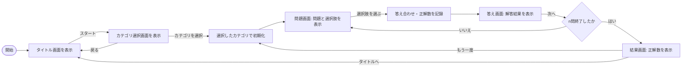

# App-Design-and-Development

## 授業内容 - 背景情報
大学授業 **アプリデザイン発展** の第5〜8回の授業内演習として、Android向けのクイズゲーム「クイズ帳」を作成する。

### 授業回

本開発演習は第5 ~ 8回授業に割り当てられる。

- [x] 第5回: チーム作成 / アプリ内容の構想
- [x] 第6回: 画面UI・クイズカテゴリの決定 / 開発着手
- [ ] 第7回: 引き続き開発を予定
- [ ] 第8回: テスト・クロージングを予定

### チーム体制
4人チームとして、以下の役割分担を行う。

1. リーダー・記録担当
2. 調査・発案担当
3. コーディング主担当 - 処理方針決定・主開発
4. コーディング副担当 - レビュー・テスト

## アプリ内容 - 要件定義

このセクションは主にコーディング担当が担当する。エージェントはコーディング担当を補佐する。

**クイズゲーム**として以下に基づいて作成する。

### 開発環境

- 端末: `Android`
- 言語: `Kotlin`
- プラットフォーム: `Android Studio`

### 処理の流れ (起案)

### 画面設計

| 画面     | 主な要素                            |
| -------- | ----------------------------------- |
| タイトル | タイトル文言 / *スタート*ボタン     |
| カテゴリ | 各*カテゴリ選択*ボタン / 各*戻る*ボタン |
| 問題     | 問題文 / 各*選択肢*ボタン                     |
| こたえ   | 答えの文言 / *次へ*ボタン           |
| 結果     | 結果(正解数, 経過時間, 指標) / *タイトルへ*ボタン / *もう一度*ボタン                                |

画面設計は [docs/wireframe/](docs/wireframe/)、動作モックは [docs/mock/prototype.html](docs/mock/prototype.html) を参照する。
資料の一覧は末尾の「参照」を確認する。

## クイズ内容

このセクションは主にリーダー・記録担当, 調査・発案担当が担当する。エージェントは自走して内容を補完せず、担当者の作成を待つ。

以下に基づいて実装する。

### カテゴリ

- 歴史
- 地理
- 理科・科学
- 英単語
- 難読漢字
- 業界用語
- プログラミング
- アニメ・映画

## 開発の進め方

コーディング主担当が処理方針の決定と主開発を担い、コーディング副担当はレビューとテストを担当する。
副担当とその支援エージェントは、主担当の方針と既存のGit運用に合わせて作業する。
変更は作業ブランチで行い、プルリクエストで共有する。
ブランチ名やPRの書き方は、[PR #1](https://github.com/Rengemaru/App-Design-and-Development/pull/1)（`docs/setup`）を参考にする。

要件と設計の詳細は [docs/](docs/) 配下の資料を正とし、AI支援の進め方は [AGENTS.md](AGENTS.md) に従う。
本READMEの処理フローは起案時の概要であり、採点や制限時間などの詳細は設計資料を参照する。

## 参照

以下の資料を参照する。

| 資料 | 配置 |
| --- | --- |
| AI支援の運用方針 | [AGENTS.md](AGENTS.md) |
| 画面構成と遷移 | [docs/wireframe/wireframe.html](docs/wireframe/wireframe.html) |
| デザイン適用後の画面 | [docs/wireframe/screen.html](docs/wireframe/screen.html) |
| 動作モック | [docs/mock/prototype.html](docs/mock/prototype.html) |
| モック用のクイズデータ | [docs/mock/quiz-data.js](docs/mock/quiz-data.js) |
